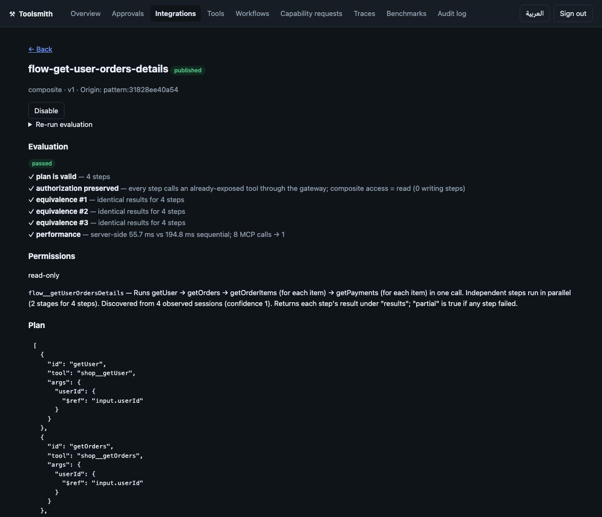
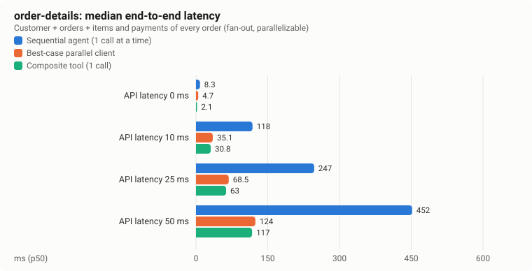
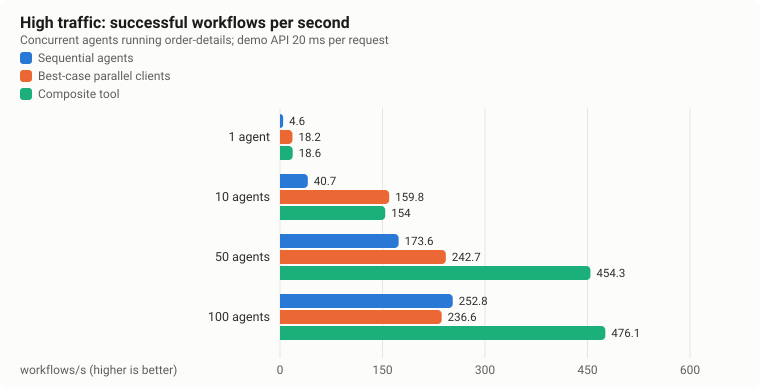
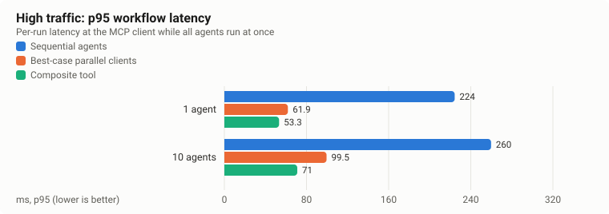
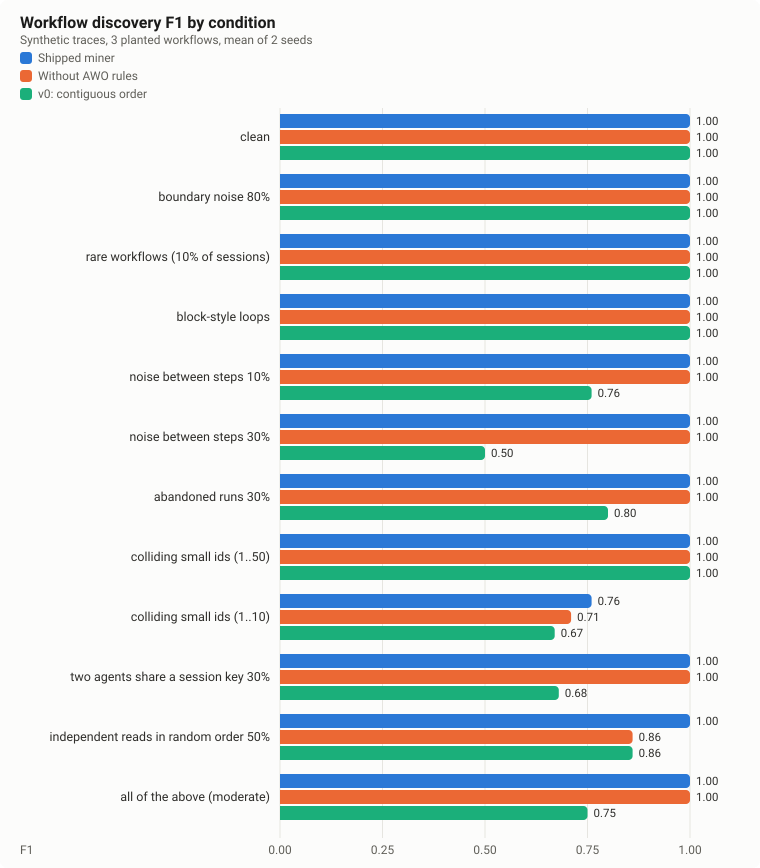

# toolsmith-mcp

**Give any AI agent the tools it needs.**

Toolsmith is an MCP gateway with three jobs:

- It turns OpenAPI/Swagger specs into MCP tools at runtime.
- It aggregates other MCP servers behind one endpoint.
- It watches how agents use those tools, finds workflows they repeat, and
  proposes **composite tools** that do the whole workflow in one call.
  Independent steps run in parallel, and the composite is checked against
  the original calls.

Nothing Toolsmith generates (API tools, composite tools) reaches an agent
until a human approves it. Destructive calls, including those of connected
MCP servers, need a human per call.

[](https://github.com/devlomingo/toolsmith-mcp/actions/workflows/ci.yml)
· Website: <https://devlomingo.github.io/toolsmith-mcp/> · MIT licensed

```sh
npm install -g toolsmith-mcp
toolsmith-mcp demo
```

The demo runs the whole lifecycle against a bundled demo shop API, then
leaves the gateway and dashboard running for you to explore.



## What it does

| | |
|---|---|
| **API → tools** | Import OpenAPI 3.x / Swagger 2.0 (file or URL, JSON or YAML), a Postman collection, a GraphQL endpoint (introspection), a plain `METHOD /path` list, or, with the optional LLM stage, free-text docs. Each operation becomes a typed MCP tool with input and output schemas, auth, timeouts, rate limits and retries for safe reads. Missing information is reported, never invented. |
| **Live verification** | Every read operation is called before review. Parameter values come from spec examples, or from another endpoint that returns them (`orderId ← listOrders[*].id`). Results are classified (`verified`, `wrong_parameter_value`, `schema_mismatch`, …). Writes are never called. Inspired by [ToolFactory](docs/PAPERS.md#toolfactory). |
| **One endpoint for every MCP server** | Upstream MCP servers (stdio or HTTP, either protocol era) are re-exposed under a prefix, with the same tracing. |
| **Workflow discovery** | Traces store keyed hashes of values, not payloads. Repeated sequences are linked by data flow and loops are detected. The AWO majority rule and commutative reads are applied ([AWO](docs/PAPERS.md#awo-optimizing-agentic-workflows-using-meta-tools)). |
| **Composite tools** | Mined workflows become declarative DAG plans: parallel stages, `forEach` fan-out, partial results. They are executed by fixed code; nothing generated runs as code. Transform steps (filter, sort, pick, first) answer requests like "the latest order". Booleans and API-declared enum values that never change are baked in. Each one tells the agent what it replaces ("Use this instead of calling … one by one"), and the reviewer can rewrite that description at approval. |
| **Evaluation** | Composites are run against the original tools one by one and must return identical results. Plans that write data are never executed automatically. |
| **Large catalogs** | Per-client allow-lists, enforced on every call. A search listing mode shows agents only a few pinned tools plus `toolsmith__search_tools`, so a big catalog does not flood the agent's context. |
| **Auth & observability** | Bearer, API key, Basic, and OAuth 2.0 client credentials (cached tokens, one-time refresh). OpenTelemetry span export, with composite steps as child spans. |
| **Missing capabilities** | Agents call `toolsmith__request_capability`. The answer is `available`, `composable` (and a composite is proposed), `needs_approval`, or `unsupported`. |
| **Human approval** | A lifecycle state machine. Generated write and destructive tools stay hidden until granted, including composites that write. Connected MCP servers are trusted by configuration, except that their destructive tools need per-call approval. Every destructive call is approved individually, in the dashboard, an interactive terminal, or (opt-in) the agent's own client via MCP elicitation, bound to its exact arguments and to the calling client's token. Versions can be rolled back. |
| **Dashboard** | Approvals, integrations, tools, workflows and usage, capability requests, traces (p50/p95), benchmarks, audit log. English and Arabic, with right-to-left layout. |
| **Protocol** | MCP 2025-11-25 and 2026-07-28 over stdio and Streamable HTTP, through the official v2 TypeScript SDK. Not tied to any client. |

## Quick start

```sh
mkdir my-tools && cd my-tools
toolsmith-mcp init                                   # config + .env with fresh tokens
toolsmith-mcp import ./openapi.yaml --name shop --token-env SHOP_TOKEN
toolsmith-mcp show shop                              # review tools, findings, verification
toolsmith-mcp approve shop                           # read-only; add --allow-writes to expose writes
toolsmith-mcp start                                  # MCP endpoint + dashboard
toolsmith-mcp client-config                          # snippets for your MCP client
```

Later, after agents have used the tools for a while:

```sh
toolsmith-mcp patterns      # repeated workflows
toolsmith-mcp discover      # propose and evaluate composites
toolsmith-mcp approve flow-get-user-orders-details
toolsmith-mcp usage         # are they used, and what do they save?
```

## Benefits, measured

All numbers come from `npm run benchmark` on a developer workstation:
Apple M1 Pro (10 cores), Node 22.13, with clients, gateway and a demo API in
one process on loopback. The full methodology, every table and the
limitations are in [benchmarks/reports/REPORT.md](benchmarks/reports/REPORT.md).

The workflow measured throughout is *"a customer, their orders, and the
items and payments of each order"*. Done by hand that is **8 MCP calls**; as
an approved composite it is **1**. Every composite run returned exactly what
the individual calls returned, with the same 8 API requests.

### Local usage: one agent



| Demo API latency | Sequential agent | Best-case parallel client | Composite |
|---|---|---|---|
| 0 ms | 8.3 ms | 4.7 ms | 2.1 ms |
| 10 ms | 118.1 ms | 35.1 ms | 30.8 ms |
| 25 ms | 247.1 ms | 68.5 ms | 63.0 ms |
| 50 ms | 451.9 ms | 124.2 ms | 117.2 ms |

What this shows:

- **About 4× faster than a sequential agent**, the way most agents call
  tools, from turning 8 round-trips into 1 and running independent steps
  in parallel.
- **The same latency as a client that already parallelizes perfectly**:
  5–12% faster at 10–50 ms API latency in this run, within noise. Against such a client the saving
  is **7 fewer MCP round-trips per task**. In a real agent each of those is
  a model turn, which this benchmark leaves out, so the saving there is
  larger than shown.
- **Strictly sequential chains gain little:** 3–7% for a 3-step dependent
  chain.

### High traffic: many agents at once

Each agent runs the workflow 10 times; the demo API takes 20 ms per
request.





| Concurrent agents | Variant | Successful workflows/s | p95 | MCP requests/s at the gateway | Failed runs |
|---|---|---|---|---|---|
| 10 | Sequential agents | 40.7 | 259.7 ms | 325 | 0 / 100 |
| 10 | Best-case parallel clients | 159.8 | 83.1 ms | 1,278 | 0 / 100 |
| 10 | **Composite** | 154.0 | **68.1 ms** | **154** | 0 / 100 |
| 50 | Sequential agents | 173.6 | 357.4 ms | 1,389 | 0 / 500 |
| 50 | Best-case parallel clients | 242.7 | 336.7 ms | 1,992 | 17 / 500 |
| 50 | **Composite** | **454.3** | **128.8 ms** | **454** | 0 / 500 |
| 100 | Sequential agents | 252.8 | 511.5 ms | 2,022 | 0 / 1,000 |
| 100 | Best-case parallel clients | 236.6 | 1,155.1 ms | 2,358 | 275 / 1,000 |
| 100 | **Composite** | **476.1** | **339.9 ms** | **476** | 0 / 1,000 |

What this shows:

- **About 1.9× the successful throughput** of the best alternative at 50
  and 100 agents.
- **A p95 1.5–3.4× lower** at 50 and 100 agents, depending on the
  comparison (1.2–3.8× at 10 agents).
- **3–5× less MCP traffic** at 50 and 100 agents (2–8× at 10), because
  each task is one request.
- **At 10 agents a perfectly parallel client keeps up**, with slightly
  higher throughput but a worse p95.

**Where the parallel client's failed runs come from.** They are client-side
connection resets, not tool errors. macOS caps the TCP accept queue at 128
(`kern.ipc.somaxconn`), and parallel clients open many connections at once.
Linux usually allows 4,096, so expect fewer failures there. The composite
opens one connection per task and never hit the limit.

### Workflow discovery accuracy



The data is synthetic traces with 3 planted workflows, 12 noise conditions
and 10 seeds each:

- **Mean F1 is 0.97**, against 0.84 for the first version of the miner.
- **It is perfect** on clean data, noise between steps, abandoned runs,
  agents sharing a session, and reordered reads.
- **It is weakest** when unrelated calls reuse tiny integer ids (ids 1..10:
  precision 0.69).

**Not measured:** LLM requests and tokens. No claim is made about them.

## Documentation

**Setting up**
- [Installation](docs/INSTALLATION.md)
- [Configuration](docs/CONFIGURATION.md)
- [Turning APIs into tools](docs/API-INTEGRATION.md)
- [Connecting MCP clients](docs/MCP-INTEGRATION.md)

**Using it**
- [Workflows and composite tools](docs/TOOL-GENERATION.md)
- [Troubleshooting](docs/TROUBLESHOOTING.md)

**Under the hood**
- [Architecture](docs/ARCHITECTURE.md)
- [Security model](docs/SECURITY.md)
- [Decision records](docs/adr/README.md)

**Background**
- [Research](docs/RESEARCH.md)
- [Competitive analysis](docs/COMPETITIVE_ANALYSIS.md)
- [Papers we build on](docs/PAPERS.md)

**Project**
- [Roadmap](docs/ROADMAP.md)
- [Changelog](CHANGELOG.md)
- [Contributing](CONTRIBUTING.md)

## Prior art

Mining agent traces into composite tools is not new. **AWO** (2026) does it
with hand-built meta-tools, and **ToolFactory** (2025) generates and
validates tools from API docs. [COMPETITIVE_ANALYSIS.md](docs/COMPETITIVE_ANALYSIS.md)
covers both, along with gateways and OpenAPI-to-MCP generators.

What Toolsmith adds is putting the pieces together behind one standard MCP
endpoint:

- arguments wired automatically from value fingerprints;
- parallel execution;
- equivalence-checked evaluation;
- a human-approval lifecycle.

## Status

Version 0.1.0:
- **Tested:** unit, integration, end-to-end over MCP, and security suites.
- **Benchmarked:** see above.
- **Independently validated:** nine rounds by a separate agent; the
  reports are in
  [docs/validation](docs/validation).

It is **not** yet hardened by production use. It runs on a single host
with SQLite storage. The [roadmap](docs/ROADMAP.md) lists what isn't built
yet: PostgreSQL storage and gRPC
sources.
