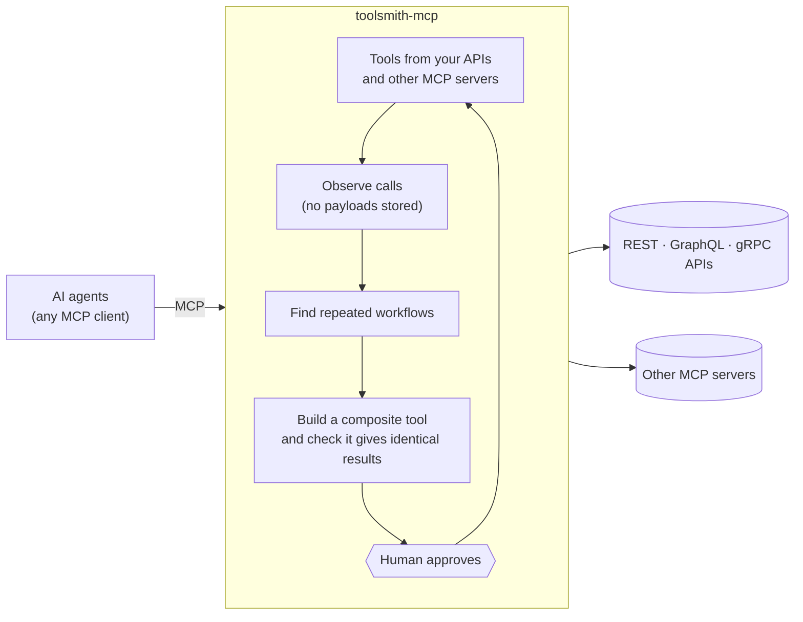

<p align="center">
  
</p>

<h1 align="center">toolsmith-mcp</h1>

<p align="center">
  <strong>Give any AI agent the tools it needs, and make the ones it uses faster.</strong><br>
  An MCP gateway that turns your APIs into tools, learns the workflows agents repeat,<br>
  and offers each one back as a single verified tool, always behind human approval.
</p>

<p align="center">
  <a href="https://devlomingo.github.io/toolsmith-mcp/"><strong>Website</strong></a> ·
  <a href="docs/INSTALLATION.md">Install</a> ·
  <a href="docs/CONFIGURATION.md">Configure</a> ·
  <a href="benchmarks/reports/REPORT.md">Benchmarks</a> ·
  <a href="CHANGELOG.md">Changelog</a>
</p>

<p align="center">
  <a href="https://www.npmjs.com/package/toolsmith-mcp"></a>
  <a href="https://github.com/devlomingo/toolsmith-mcp/actions/workflows/ci.yml"></a>
  
  
</p>

---

## Try it in one minute

```sh
npm install -g toolsmith-mcp
toolsmith-mcp demo
```

The demo runs the whole lifecycle against a bundled shop API: import, verify,
approve, record agent traffic, discover a workflow, evaluate it, and serve it.
It then leaves the gateway and the dashboard running for you to explore.

<p align="center">
  
</p>

## Why it helps

| | Without Toolsmith | With Toolsmith |
|---|---|---|
| **Getting tools** | Write an MCP server per API | Point it at an OpenAPI, GraphQL or gRPC API and review the generated tools |
| **Many servers** | Configure each one in every client | One endpoint for all of them, with one allow-list per client |
| **Repeated work** | The agent makes 8 calls, one model turn each | One composite tool does it in 1 call, with independent steps in parallel |
| **Safety** | Whatever a server exposes, the agent can call | Nothing generated is exposed until a human approves it, and every destructive call needs its own approval |

**Measured on the 8-call workflow below:** about **4× faster** than a
sequential agent, and at 50–100 concurrent agents **1.9× the throughput**
with **3–5× less MCP traffic**, with results identical to the original calls.
[Details ↓](#benefits-measured)

## How it works



1. **Import** an API. Every operation becomes a typed tool, and read
   operations are called once to verify them.
2. **Approve** it. Read tools go live; write and destructive tools stay
   hidden until you grant them.
3. **Let agents work.** Toolsmith records which tools they call and how
   values flow between calls.
4. **Discover.** A workflow agents repeat becomes a proposed composite tool.
   It is checked against the original calls, then waits for your approval.

## What's inside

<table>
<tr>
<td width="50%" valign="top">

**🔌 Connect anything**
- OpenAPI 3.x / Swagger 2.0, Postman, GraphQL, **gRPC** (`.proto` or server reflection), plain endpoint lists
- Other MCP servers behind one endpoint, under a prefix
- Optional: free-text API docs through an LLM stage
- Bearer, API key, Basic and OAuth 2.0 client credentials toward APIs

</td>
<td width="50%" valign="top">

**🧠 Learn from usage**
- Workflow discovery from data flow, not just call order
- Tolerates noise, abandoned runs and optional side calls
- Composite tools: parallel stages, `forEach`, filter / sort / pick
- Usage stats: calls saved, adoption, unused tools

</td>
</tr>
<tr>
<td valign="top">

**🛡️ Safe by default**
- Human approval for everything generated, with versions and rollback
- Per-call approval for destructive actions, in the dashboard, the terminal or the agent's client
- SSRF guard, secret redaction, tool-poisoning tripwire
- Traces keep keyed hashes, never tool results

</td>
<td valign="top">

**🏢 Ready for teams**
- **OAuth 2.1 sign-in** for MCP clients, with your own authorization server
- **Per-client** allow-lists and **rate limits**
- **PostgreSQL**, so several gateway nodes share one state
- OpenTelemetry export; dashboard in English and Arabic (RTL)

</td>
</tr>
</table>

**New in 0.2.0:** OAuth 2.1 resource server, per-client rate limits, gRPC
sources, workflows with gaps, and PostgreSQL storage. See the
[changelog](CHANGELOG.md).

## Quick start with your own API

```sh
mkdir my-tools && cd my-tools
toolsmith-mcp init                                       # config + .env with fresh tokens
toolsmith-mcp import ./openapi.yaml --name shop --token-env SHOP_TOKEN
toolsmith-mcp show shop                                  # review tools, findings, verification
toolsmith-mcp approve shop                               # read-only; --allow-writes to expose writes
toolsmith-mcp start                                      # MCP endpoint + dashboard
toolsmith-mcp client-config                              # snippets for your MCP client
```

After agents have used the tools for a while:

```sh
toolsmith-mcp patterns                                   # repeated workflows
toolsmith-mcp discover                                   # propose and evaluate composites
toolsmith-mcp approve flow-get-user-orders-details
toolsmith-mcp usage                                      # are they used, and what do they save?
```

More: [connecting MCP clients](docs/MCP-INTEGRATION.md) ·
[turning APIs into tools](docs/API-INTEGRATION.md) ·
[workflows and composites](docs/TOOL-GENERATION.md)

## Benefits, measured

The workflow measured throughout: *a customer, their orders, and the items
and payments of each order*. By hand that is **8 MCP calls**; as an approved
composite it is **1**, and every composite run returned exactly what the
individual calls returned.

All numbers come from `npm run benchmark` on an Apple M1 Pro with Node 22.13,
with clients, gateway and demo API in one process. No LLM is involved, so
the model turns a composite saves are not counted, and nothing is claimed
about tokens. [Full report and methodology](benchmarks/reports/REPORT.md).

### One agent, local

<p align="center">
  
</p>

- **About 4× faster than a sequential agent**, the way most agents call
  tools.
- **As fast as a client that already parallelizes perfectly** (5–12%
  faster, within noise), while making **7 fewer round-trips**. In a real
  agent each of those is a model turn.
- **Little gain for strictly sequential chains:** 3–7% for 3 dependent
  steps.

<details>
<summary>Table: median latency per workflow run</summary>

| Demo API latency | Sequential agent | Best-case parallel client | Composite |
|---|---|---|---|
| 0 ms | 8.3 ms | 4.7 ms | 2.1 ms |
| 10 ms | 118.1 ms | 35.1 ms | 30.8 ms |
| 25 ms | 247.1 ms | 68.5 ms | 63.0 ms |
| 50 ms | 451.9 ms | 124.2 ms | 117.2 ms |

</details>

### Many agents at once

Each agent runs the workflow 10 times; the demo API takes 20 ms per request.

<p align="center">
  
</p>
<p align="center">
  
</p>

- **About 1.9× the throughput** of the best alternative at 50 and 100
  agents.
- **1.5–3.4× lower p95 latency** at 50 and 100 agents.
- **3–5× less MCP traffic** at 50 and 100 agents, because each task is one
  request.
- At 10 agents, a perfectly parallel client keeps up, with a slightly worse
  p95.

<details>
<summary>Table: throughput, latency and failures by concurrency</summary>

| Agents | Variant | Workflows/s | p95 | MCP requests/s | Failed runs |
|---|---|---|---|---|---|
| 10 | Sequential | 40.7 | 259.7 ms | 325 | 0 / 100 |
| 10 | Parallel client | 159.8 | 83.1 ms | 1,278 | 0 / 100 |
| 10 | **Composite** | 154.0 | **68.1 ms** | **154** | 0 / 100 |
| 50 | Sequential | 173.6 | 357.4 ms | 1,389 | 0 / 500 |
| 50 | Parallel client | 242.7 | 336.7 ms | 1,992 | 17 / 500 |
| 50 | **Composite** | **454.3** | **128.8 ms** | **454** | 0 / 500 |
| 100 | Sequential | 252.8 | 511.5 ms | 2,022 | 0 / 1,000 |
| 100 | Parallel client | 236.6 | 1,155.1 ms | 2,358 | 275 / 1,000 |
| 100 | **Composite** | **476.1** | **339.9 ms** | **476** | 0 / 1,000 |

The parallel client's failed runs are client-side connection resets, not
tool errors: macOS caps the TCP accept queue at 128, and parallel clients
open many connections at once. Linux usually allows 4,096.

</details>

### Workflow discovery accuracy

<p align="center">
  
</p>

On synthetic traces with 3 planted workflows, 14 noise conditions and 10
seeds each:

- **Mean F1 0.97**, against 0.75 for the first version of the miner.
- **Perfect** on clean data, noise between steps, abandoned runs, agents
  sharing a session, reordered reads, and colliding ids 1..10 (ids 1..50:
  F1 0.99).
- **Optional side calls no longer hide a workflow:** F1 0.92 with them in
  30% of runs, against 0.59 when only adjacent steps count.
- **Weakest on rare workflows** (10% of sessions: recall 0.83).

## Documentation

| Get started | Use it | Understand it |
|---|---|---|
| [Installation](docs/INSTALLATION.md) | [Workflows and composite tools](docs/TOOL-GENERATION.md) | [Architecture](docs/ARCHITECTURE.md) |
| [Configuration](docs/CONFIGURATION.md) | [Troubleshooting](docs/TROUBLESHOOTING.md) | [Security model](docs/SECURITY.md) |
| [Turning APIs into tools](docs/API-INTEGRATION.md) | [Roadmap](docs/ROADMAP.md) | [Decision records](docs/adr/README.md) |
| [Connecting MCP clients](docs/MCP-INTEGRATION.md) | [Changelog](CHANGELOG.md) | [Research](docs/RESEARCH.md) · [Papers](docs/PAPERS.md) · [Competitors](docs/COMPETITIVE_ANALYSIS.md) |

## Prior art, and what is new here

Mining agent traces into composite tools is not new: **AWO** (2026) builds
meta-tools by hand, and **ToolFactory** (2025) generates and validates tools
from API docs ([how we build on both](docs/PAPERS.md)). Toolsmith puts the
pieces together behind one standard MCP endpoint: arguments wired
automatically from value fingerprints, parallel execution,
equivalence-checked evaluation, and a human-approval lifecycle.

## Status

**Version 0.2.0**
- **Tested:** unit, integration, end-to-end over MCP and security suites,
  on SQLite and on PostgreSQL (including multi-node tests).
- **Validated:** fifteen rounds by an independent agent
  ([reports](docs/validation)).
- **Not yet hardened by production use.** Runs on one host with SQLite, or
  as several nodes sharing PostgreSQL.

[Contributing](CONTRIBUTING.md) · [Security policy](SECURITY.md) ·
[Code of conduct](CODE_OF_CONDUCT.md) · MIT licensed
