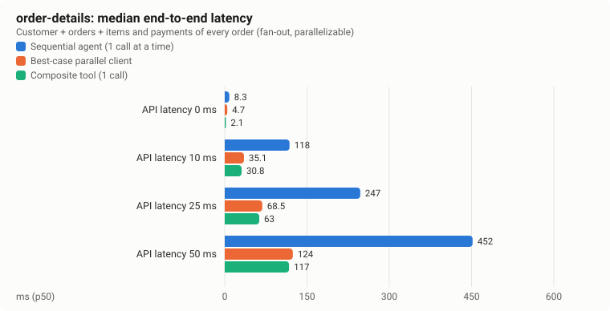
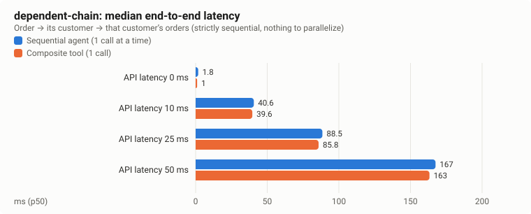
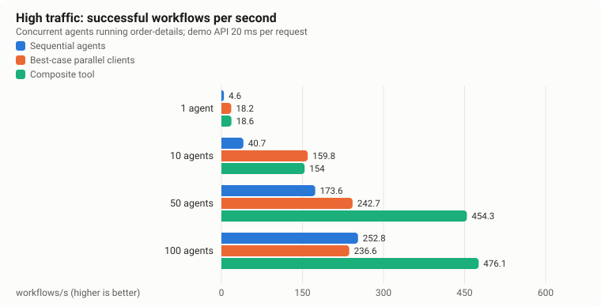
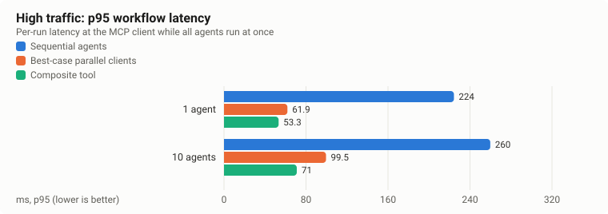
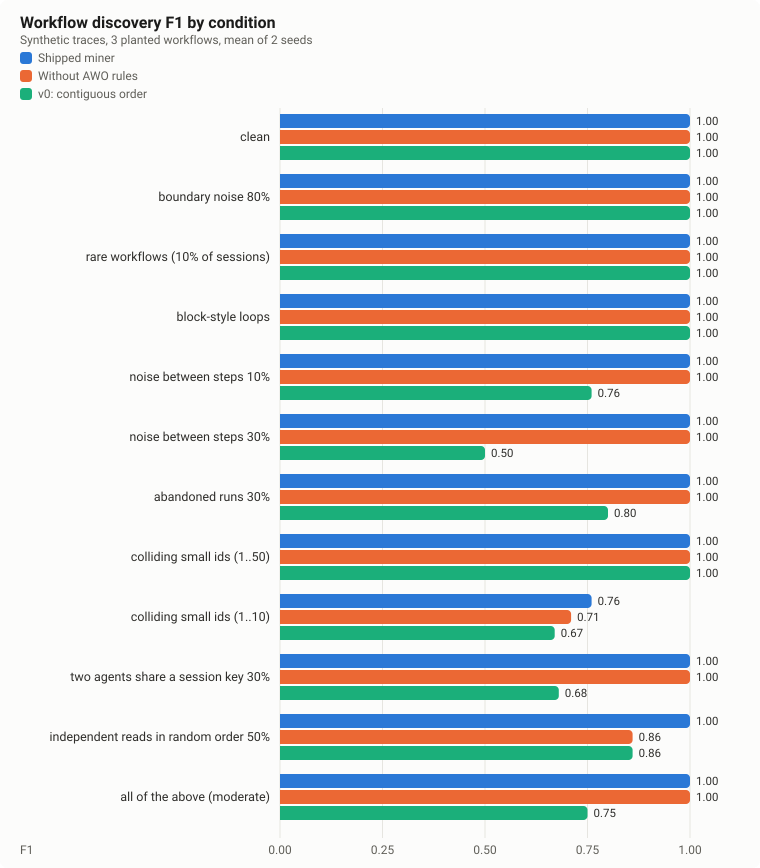
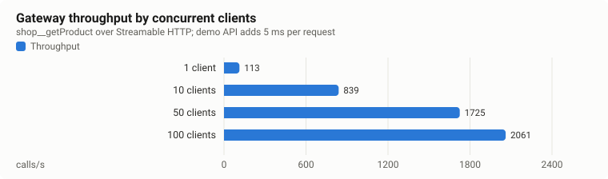

# Benchmark report

Generated 2026-11-07T22:11:15.943Z from the JSON files in `benchmarks/results/`. Nothing in this report is estimated or hand-edited.

**Environment:** toolsmith-mcp 0.1.0 (commit `8a4fd8b`), Node v22.13.1, darwin 27.2.0 arm64, Apple M1 Pro (10 cores, 17 GB), MCP SDK server 2.4.0 / client 2.4.0, developer workstation.

## Workflow latency: baseline vs composite

40 measured runs per variant after 5 warm-up runs.

- Latency is measured at the MCP client: one workflow run, end to end, over Streamable HTTP on loopback (protocol 2026-07-28).
- No LLM is involved. Agent reasoning time between tool calls is NOT included, so real agents see larger absolute savings per avoided round-trip; this benchmark does not measure that and makes no claim about it.
- LLM requests and tokens are not measured. resultBytesPerRun is the size of tool results returned to the client, not a token count.
- apiRequests is counted by the demo API server itself.
- correctness = fraction of runs whose result deep-equals a sequential reference run for the same input.

### order-details

Customer + orders + items and payments of every order (fan-out, parallelizable)

| API latency | Variant | p50 ms | p95 ms | p99 ms | MCP calls | API requests | Correct | Success | CPU ms/run | Result bytes |
|---|---|---|---|---|---|---|---|---|---|---|
| 0 ms | sequential | 7.97 | 10.59 | 12.09 | 8 | 8 | 100% | 100% | 26.03 | 1796 |
| 0 ms | parallel-client | 4.52 | 6.67 | 7.68 | 8 | 8 | 100% | 100% | 18.01 | 1796 |
| 0 ms | composite | 1.96 | 2.91 | 4.07 | 1 | 8 | 100% | 100% | 11.58 | 2157 |
| 10 ms | sequential | 120.46 | 132.7 | 137.56 | 8 | 8 | 100% | 100% | 75.06 | 1796 |
| 10 ms | parallel-client | 36.01 | 41.89 | 42.86 | 8 | 8 | 100% | 100% | 50.55 | 1796 |
| 10 ms | composite | 32.74 | 37.82 | 38.79 | 1 | 8 | 100% | 100% | 43.03 | 2157 |
| 25 ms | sequential | 251.07 | 260.22 | 260.75 | 8 | 8 | 100% | 100% | 86.93 | 1796 |
| 25 ms | parallel-client | 67.48 | 74.11 | 76.98 | 8 | 8 | 100% | 100% | 63.49 | 1796 |
| 25 ms | composite | 63.31 | 67.59 | 69.59 | 1 | 8 | 100% | 100% | 52.94 | 2157 |
| 50 ms | sequential | 458.43 | 467.68 | 479.18 | 8 | 8 | 100% | 100% | 113.44 | 1796 |
| 50 ms | parallel-client | 120.91 | 126.67 | 126.92 | 8 | 8 | 100% | 100% | 82.71 | 1796 |
| 50 ms | composite | 115.34 | 120.64 | 124.25 | 1 | 8 | 100% | 100% | 67.03 | 2157 |

### dependent-chain

Order → its customer → that customer’s orders (strictly sequential, nothing to parallelize)

| API latency | Variant | p50 ms | p95 ms | p99 ms | MCP calls | API requests | Correct | Success | CPU ms/run | Result bytes |
|---|---|---|---|---|---|---|---|---|---|---|
| 0 ms | sequential | 1.94 | 4.63 | 5.74 | 3 | 3 | 100% | 100% | 5.48 | 735 |
| 0 ms | composite | 1.18 | 1.39 | 2.36 | 1 | 3 | 100% | 100% | 4.05 | 960 |
| 10 ms | sequential | 44.73 | 49.68 | 55.41 | 3 | 3 | 100% | 100% | 24.72 | 735 |
| 10 ms | composite | 42.25 | 47.25 | 48.73 | 1 | 3 | 100% | 100% | 21.4 | 960 |
| 25 ms | sequential | 92.83 | 98.55 | 99.72 | 3 | 3 | 100% | 100% | 30.64 | 735 |
| 25 ms | composite | 88.54 | 92.87 | 94.49 | 1 | 3 | 100% | 100% | 27.13 | 960 |
| 50 ms | sequential | 171.46 | 176.16 | 178.32 | 3 | 3 | 100% | 100% | 36.8 | 735 |
| 50 ms | composite | 167.09 | 172.19 | 177.39 | 1 | 3 | 100% | 100% | 30.75 | 960 |

## High traffic

- Each agent runs the order-details workflow 3 times back to back; all agents start together. The demo API adds 20 ms per request.
- Clients, gateway and demo API share one Node process on one machine, so CPU and memory figures cover all three and throughput is bounded by that single process.
- No LLM is involved; agent reasoning time between calls is excluded.

| Agents | Variant | Workflows/s | p50 ms | p95 ms | p99 ms | MCP calls/run | MCP requests/s | API requests/run | Errors | CPU s/run (whole process) |
|---|---|---|---|---|---|---|---|---|---|---|
| 1 | sequential | 4.7 | 212.34 | 224.33 | 224.33 | 8 | 37 | 8 | 0 | 0.0599 |
| 1 | parallel-client | 16.6 | 60.75 | 61.87 | 61.87 | 8 | 133 | 8 | 0 | 0.0221 |
| 1 | composite | 19.6 | 51.09 | 53.29 | 53.29 | 1 | 20 | 8 | 0 | 0.0149 |
| 10 | sequential | 40.9 | 237.39 | 259.78 | 260.01 | 8 | 327 | 8 | 0 | 0.0136 |
| 10 | parallel-client | 130.3 | 70.21 | 99.53 | 104.38 | 8 | 1042 | 8 | 0 | 0.0133 |
| 10 | composite | 147.4 | 68.29 | 71.01 | 73.14 | 1 | 147 | 8 | 0 | 0.0038 |

## Workflow discovery accuracy

- Synthetic data: 3 planted workflows (fan-out loop, 3-step dependent chain, list+loop) plus 7 noise tools. This measures the algorithm, not real agent behaviour.
- Recall is computed over all 3 planted workflows; with rare workflows a workflow can run fewer than minSupport (3) times, which caps recall by design.
- Ablation: "contiguous (v0 baseline)" mines raw call order with a 0.9 closed-pattern ratio (the first implementation). "default" splits sessions into data-flow components and uses a 0.6 ratio.

| Condition | Miner | Precision | Recall | F1 (mean ± sd) | Mining ms (p50) |
|---|---|---|---|---|---|
| clean | default | 1 | 1 | 1 ± 0 | 5.14 |
| clean | no AWO rules | 1 | 1 | 1 ± 0 | 3.27 |
| clean | contiguous (v0 baseline) | 1 | 1 | 1 ± 0 | 2.81 |
| boundary noise 80% | default | 1 | 1 | 1 ± 0 | 4.92 |
| boundary noise 80% | no AWO rules | 1 | 1 | 1 ± 0 | 2.48 |
| boundary noise 80% | contiguous (v0 baseline) | 1 | 1 | 1 ± 0 | 2.87 |
| rare workflows (10% of sessions) | default | 1 | 1 | 1 ± 0 | 0.87 |
| rare workflows (10% of sessions) | no AWO rules | 1 | 1 | 1 ± 0 | 0.74 |
| rare workflows (10% of sessions) | contiguous (v0 baseline) | 1 | 1 | 1 ± 0 | 1.54 |
| block-style loops | default | 1 | 1 | 1 ± 0 | 1.66 |
| block-style loops | no AWO rules | 1 | 1 | 1 ± 0 | 1.7 |
| block-style loops | contiguous (v0 baseline) | 1 | 1 | 1 ± 0 | 1.54 |
| noise between steps 10% | default | 1 | 1 | 1 ± 0 | 1.94 |
| noise between steps 10% | no AWO rules | 1 | 1 | 1 ± 0 | 1.71 |
| noise between steps 10% | contiguous (v0 baseline) | 0.63 | 1 | 0.76 ± 0.1 | 2.03 |
| noise between steps 30% | default | 1 | 1 | 1 ± 0 | 2.05 |
| noise between steps 30% | no AWO rules | 1 | 1 | 1 ± 0 | 1.71 |
| noise between steps 30% | contiguous (v0 baseline) | 0.33 | 1 | 0.5 ± 0 | 2.37 |
| abandoned runs 30% | default | 1 | 1 | 1 ± 0 | 2.16 |
| abandoned runs 30% | no AWO rules | 1 | 1 | 1 ± 0 | 1.92 |
| abandoned runs 30% | contiguous (v0 baseline) | 0.68 | 1 | 0.8 ± 0.05 | 1.56 |
| colliding small ids (1..50) | default | 1 | 1 | 1 ± 0 | 1.85 |
| colliding small ids (1..50) | no AWO rules | 1 | 1 | 1 ± 0 | 1.76 |
| colliding small ids (1..50) | contiguous (v0 baseline) | 1 | 1 | 1 ± 0 | 1.89 |
| colliding small ids (1..10) | default | 0.63 | 1 | 0.76 ± 0.1 | 2.4 |
| colliding small ids (1..10) | no AWO rules | 0.55 | 1 | 0.71 ± 0.04 | 2.25 |
| colliding small ids (1..10) | contiguous (v0 baseline) | 0.5 | 1 | 0.67 ± 0 | 2.13 |
| two agents share a session key 30% | default | 1 | 1 | 1 ± 0 | 2.21 |
| two agents share a session key 30% | no AWO rules | 1 | 1 | 1 ± 0 | 1.98 |
| two agents share a session key 30% | contiguous (v0 baseline) | 0.51 | 1 | 0.68 ± 0.07 | 2.47 |
| independent reads in random order 50% | default | 1 | 1 | 1 ± 0 | 1.84 |
| independent reads in random order 50% | no AWO rules | 0.75 | 1 | 0.86 ± 0 | 1.64 |
| independent reads in random order 50% | contiguous (v0 baseline) | 0.75 | 1 | 0.86 ± 0 | 2.21 |
| all of the above (moderate) | default | 1 | 1 | 1 ± 0 | 1.85 |
| all of the above (moderate) | no AWO rules | 1 | 1 | 1 ± 0 | 1.62 |
| all of the above (moderate) | contiguous (v0 baseline) | 0.6 | 1 | 0.75 ± 0 | 2.12 |

Overall mean across conditions (shipped miner): precision 0.97, recall 1, F1 0.98. v0 baseline: F1 0.84.

## Scalability

- Single process on one machine; the demo API adds 5 ms latency per request in the throughput test. Loopback networking only.

RSS is the resident memory of the single benchmark process, which hosts the MCP clients, the gateway and the demo API together. It is an upper bound for the gateway alone.

| Concurrent clients | Calls | Errors | Calls/s | p50 ms | p95 ms | p99 ms | RSS MB (whole process) |
|---|---|---|---|---|---|---|---|
| 1 | 100 | 0 | 112 | 8.63 | 10.17 | 13.59 | 450 |
| 10 | 1000 | 0 | 731 | 13.66 | 17.31 | 21.95 | 553 |
| 50 | 5000 | 0 | 1642 | 30 | 39.4 | 50.98 | 896 |
| 100 | 10000 | 0 | 1994 | 48 | 58.61 | 95.05 | 1018 |

| Traces mined | Sessions | Mining ms (p50) |
|---|---|---|
| 872 | 200 | 5.78 |
| 4390 | 1000 | 13.72 |
| 21908 | 5000 | 71.95 |
| 87862 | 20000 | 300.01 |

| Operations in spec | Tools listed | Import ms | Catalog rebuild ms | tools/list p50 ms |
|---|---|---|---|---|
| 50 | 51 | 59 | 1 | 1.16 |
| 200 | 201 | 54 | 1.9 | 2.96 |
| 1000 | 1001 | 145 | 8.7 | 11.84 |
| 2000 | 2001 | 217 | 18.8 | 37.62 |

## What these numbers do not show

- **LLM requests and tokens were not measured.** No LLM runs in these benchmarks. Fewer MCP calls usually means fewer agent turns, but this report makes no token or cost claim.
- **Agent reasoning time is excluded.** In a real agent, each avoided round-trip also saves a model turn, which is typically far slower than the API calls measured here.
- **Loopback only.** Client, gateway and API run on one machine; real networks add latency to every call, which favours composites.
- **Synthetic data for pattern discovery.** The planted workflows and noise model are ours; real traces will differ.

