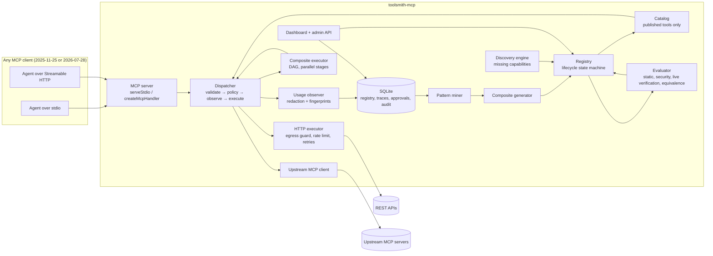
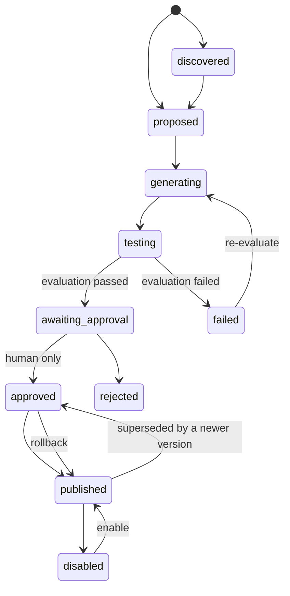

# Architecture

toolsmith-mcp is one Node process. To an agent it looks like a normal MCP
server. Behind that interface it combines three kinds of tools: tools
generated from API specs, tools from other MCP servers, and composite tools
it discovered and a human approved. Every call goes through one path that
validates the call, applies policy and records a trace.

## Components

The brief's component list maps to code as follows.

| Component | Code | Responsibility |
|---|---|---|
| Universal MCP gateway | `src/server/mcp.ts`, `http.ts`, `stdio.ts`, `src/gateway/gateway.ts` | Serve MCP over stdio and Streamable HTTP in both protocol eras; route calls to the right executor; aggregate upstream servers under `<name>__` prefixes |
| API integration builder | `src/openapi/import.ts`, `endpoints.ts`, `http-executor.ts` | Parse OpenAPI 3.x / Swagger 2.0 (JSON/YAML, local or URL) or plain endpoint lists; produce operation descriptors with input/output schemas, access level, findings; execute them safely |
| Tool discovery engine | `src/discovery/discovery.ts` | Match a natural-language request against published tools and imported-but-unpublished operations; build a chain from schema links; answer `available` / `composable` / `needs_approval` / `unsupported` |
| Usage observer | `src/observer/observer.ts` | Wrap every call; record timing, outcome, upstream request count, redacted args and value fingerprints |
| Trace storage | `src/observer/trace-store.ts`, `src/store/db.ts` | Query, stats (p50/p95), retention |
| Pattern discovery engine | `src/patterns/miner.ts` | Episodes → data-flow components → canonical reads → loop folding → n-gram and dependency-closed subsequence support → majority rule → closed patterns, with argument-source voting |
| Composite tool generator | `src/composite/generator.ts`, `plan.ts`, `executor.ts` | Turn a pattern into a declarative plan; validate it; execute it with parallel stages, bounded fan-out, partial results |
| MCP server generator | `src/gateway/gateway.ts` (Catalog) + `src/registry/registry.ts` | Group operations of one spec into one integration (an artifact) with versions; expose the published version; rollback |
| Tool evaluator | `src/evaluator/evaluator.ts`, `src/openapi/verify.ts` | Static checks, security checks, live verification of read operations, equivalence test for composites, performance comparison |
| Tool registry | `src/registry/registry.ts` | Lifecycle states, transitions, human-only approval, permissions, versions, audit events |
| Other tool sources | `src/openapi/postman.ts`, `src/graphql/graphql.ts`, `src/openapi/endpoints.ts` | Postman collections, GraphQL introspection and plain endpoint lists, all turned into the same operation descriptors |
| Exposure policy | `Toolsmith.allowed` / `listedTools` / `searchTools` in `src/app.ts` | Per-client allow-lists (enforced on calls), search listing mode, `toolsmith__search_tools` |
| Optional LLM stage | `src/llm/llm.ts` | Off by default. Extracts endpoints from free-text docs into a schema that is then verified like any spec, and suggests existing tools when keyword matching fails |
| Telemetry | `src/observer/otel.ts` | OTLP/HTTP span export, with composite steps as child spans |
| Developer dashboard | `dashboard/`, `src/server/admin-api.ts` | Overview, approvals, integrations, tools, workflows and usage, capability requests, traces, benchmarks, audit log (English and Arabic, RTL) |

The brief also lists an "MCP server generator". There is no per-API
source-code generation, because one runtime serves every integration (see
[ADR 0004](adr/0004-no-generated-code.md)). An "MCP server" in this
project is a group of tools under one namespace, served by the gateway.

## Lifecycle

- Imports enter at `generating`. Proposed composites, whether mined or from
  a capability request, enter at `proposed`. Configured upstream servers are
  recorded as published by `human:config`, because the operator added them.
- Approval stores the granted permissions: write and destructive operations
  stay hidden unless granted.
- A version that failed evaluation cannot be approved.

## A tool call, step by step

1. The client calls `tools/call`. Under 2026-07-28 that is a stateless
   request; under 2025 it is a stateless legacy request or a stdio session.
2. The **dispatcher** looks up the tool in the catalog. Only published,
   granted tools are present.
3. It validates the arguments against the input schema (Ajv). Unknown
   arguments are rejected.
4. **Policy:** a destructive tool needs a matching, unused per-call approval
   from the same session. This covers API DELETE operations, and upstream
   tools that are annotated destructive or not annotated at all. Otherwise
   the dispatcher creates a pending approval and returns
   `approval_required` with its id.
5. The **observer** starts a trace and runs the executor:
   - **OpenAPI:** build the URL, with path parameters percent-encoded and an
     origin check. Apply auth from environment variables, then the token
     bucket. A connect-time DNS check refuses private addresses. Redirects
     are never followed. There is a timeout and a 5 MB response cap.
     Bounded retries apply only to safe reads, honouring `Retry-After`.
   - **Upstream:** forward to the upstream MCP client and pass its content
     through unchanged.
   - **Composite:** schedule plan steps as soon as their dependencies
     finish. Each step is a full dispatcher call, so steps get the same
     validation, policy, rate limits and traces, linked to their parent.
6. The output is validated against the output schema when one is declared,
   then returned as `structuredContent` plus a JSON text block.

## Workflow discovery, step by step

1. **Episodes:** top-level, successful traces grouped by session and split
   at idle gaps (default 2 minutes).
2. **Data-flow components:** an argument whose fingerprint equals an
   earlier argument (a shared input) or an earlier result leaf (an output
   link) is bound to the value's *origin*. Only links with name evidence
   join calls into one component. Unrelated calls and a second agent behind
   the same session key fall into other components.
3. **Canonical reads** (after AWO's set of reads): adjacent reads that do not
   consume each other's output are counted in a canonical order. Loops act
   as barriers.
4. **Loop folding:** consecutive calls that iterate over the same array of
   an earlier result (`orders[*]`) become one `loop(...)` element.
5. **Counting:** contiguous element n-grams, plus dependency-closed
   subsequences inside a component: steps need not be adjacent, but every
   step must consume a value from an earlier chosen step. So an optional
   linked side call (a settings lookup on the same `userId`) does not hide
   the workflow around it. Each sequence counts at most once per episode. A
   pattern must reach `minSupport` and stay connected. Each step must pass
   the majority rule: more than 50% of the sessions that reached its prefix
   go on to it (AWO's `SELECT_CHILD`). Fragments explained by a longer
   pattern (as a subsequence) are dropped.
6. **Argument sources:** for every argument, the most common source across
   occurrences wins if it reaches `minConfidence`: an input, an output path,
   a loop item field, or a shared input. When the call that first held a
   value is not part of the pattern, the value is taken from the earliest
   step in the pattern that received it under the same argument name.
   Otherwise the argument becomes an input.
7. **Generation:** the plan is built in the order agents actually ran the
   steps. Inputs are typed from the underlying tools' schemas, and example
   inputs come from redacted arguments.
8. **Evaluation:** the plan is validated statically. Plans that write data
   are never executed by the evaluator. For read-only plans, the evaluator
   runs a *separate, sequential* reference interpreter on the original
   tools and then the real parallel executor, and requires identical
   per-step results. It also records latency and MCP call counts.
9. A human approves the composite.
10. After publication, usage is tracked: calls, round-trips saved, and how
    often agents still run the workflow by hand.

## Storage

One SQLite database in `<dataDir>/toolsmith.db`, or a PostgreSQL database
shared by several gateway nodes (`database.url`). Every component talks to
a small async interface (`SqlDb`: `all`, `get`, `run`, `transaction`) with
one portable SQL text. SQLite serialises statements behind a lock so a
transaction never absorbs another caller's statements. PostgreSQL runs
transactions `SERIALIZABLE`, retried on conflicts, so check-then-write steps
(the next version number, spending an approval) stay correct when nodes
race. Tables:

| Table | Holds |
|---|---|
| `artifacts`, `artifact_versions` | Integrations, upstreams and composites, with versioned definitions, status, permissions and evaluation |
| `lifecycle_events` | Every status change, with the actor and reason |
| `traces` | One row per call (composite steps link to their parent), with redacted args and fingerprints |
| `call_approvals` | Per-call approvals for destructive operations |
| `capability_requests` | Discovery analyses |
| `audit_log` | Administrative actions |
| `settings` | Catalog revision counter, fingerprint HMAC key |

## Extension points

- **A new tool source** (for example GraphQL) implements
  `ToolExecutor`-style execution, publishes descriptors through the
  registry, and plugs into `Catalog.rebuild`.
- **A different store** implements `SqlDb` (see `src/store/postgres.ts`)
  and its own migrations.
- **An optional LLM stage** (extraction from free-text docs, or richer
  capability matching) would sit in front of `importOpenApi` or
  `DiscoveryEngine.analyze`. Its output goes through the same evaluation
  and approval.
